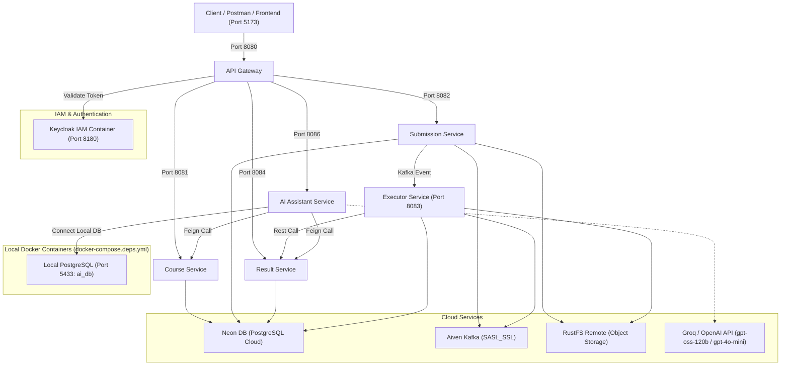

# Hướng Dẫn Khởi Chạy Hệ Thống Ở Môi Trường Dev (Deployed Dev)

Tài liệu này hướng dẫn chi tiết cách khởi chạy các container và microservices trong môi trường **Dev**, trong đó:
- **Cloud Infrastructure:** Neon PostgreSQL, Aiven Kafka, RustFS Object Storage, (tuỳ chọn) Keycloak Remote.
- **Local Container:** Keycloak IAM (`wgs-keycloak` chạy qua Docker Compose deps).
- **Backend Services:** API Gateway, Course Service, Submission Service, Executor Service, Result Service, **AI Assistant Service**.
- **Frontend SPA:** React 19 + TypeScript + Ant Design 6.

---

## 1. Kiến Trúc Môi Trường Dev (Hybrid: Dev Cloud + Local AI DB)



### Bảng Phân Bổ Cổng & Vai Trò Các Thành Phần

| Thành phần | Loại | Địa chỉ / Port | Ghi chú |
|---|---|---|---|
| **Database (Chính)** | Cloud (Neon DB) | `ep-flat-base-...neon.tech:5432` | Chứa DB: `assignment_db`, `submission_db`, `result_db`, `executor_db` |
| **Database (AI Service)** | **Local Container** | `localhost:5433/ai_db` | Container `wgs-postgres-db` chứa bảng `ai_explanations` và các bảng AI Agent |
| **Kafka Broker** | Cloud (Aiven) | `wc-test-truonggiang.g.aivencloud.com:23886` | SASL_SSL với CA cert |
| **Object Storage** | Cloud (RustFS) | `https://web-dev1-rustfs-api.vucongtuanduong.dpdns.org` | Bucket: `submission-files` |
| **Keycloak IAM** | Local Container | `http://localhost:8180` | Container `wgs-keycloak`, Realm: `ptit-wgs`, Client: `web-grading-fe` |
| **API Gateway** | Microservice | `http://localhost:8080` | Định tuyến toàn bộ API `/api/v1/**`, xác thực JWT |
| **Course Service** | Microservice | `http://localhost:8081` | Quản lý môn học, lớp, bài tập, test plan |
| **Submission Service** | Microservice | `http://localhost:8082` | Nhận bài nộp, cấp presigned URL, gửi Kafka event |
| **Executor Service** | Microservice / Worker | `http://localhost:8083` | Docker Sandbox Runner, chấm bài theo 4 loại test step |
| **Result Service** | Microservice | `http://localhost:8084` | Lưu trữ chi tiết điểm số, telemetry và kết quả chấm |
| **AI Assistant Service** | Microservice | `http://localhost:8086` | AI Trợ giảng & AI Agent tương tác đa lượt (DB local, Feign trỏ Dev) |
| **Frontend Web App** | React SPA | `http://localhost:5173` | Giao diện Giảng viên & Sinh viên |

---

## 2. Chuẩn Bị & Chuyển Đổi Môi Trường

Mở **PowerShell** tại thư mục gốc backend (`web-grading-system-backend-services`) và chạy script:

```powershell
.\switch-env.ps1 dev
```

> [!TIP]
> Nếu bạn muốn chuyển đổi đồng bộ cả Backend và Frontend chỉ bằng 1 lệnh từ thư mục gốc dự án (`DATN`), hãy chạy:
> ```powershell
> .\switch-keycloak-env.ps1 dev
> ```

Script sẽ tự động copy các file cấu hình `.env.dev` sang `.env` ở thư mục gốc và ở tất cả 6 service con.

---

## 3. Bước 1: Khởi Chạy Containers Phụ Thuộc (PostgreSQL & Keycloak)

Trong mô hình này:
- **`postgres-db` (Port host 5433):** Lưu trữ riêng cơ sở dữ liệu `ai_db` cho AI Assistant Service tại local.
- **`keycloak` (Port host 8180):** Quản lý xác thực người dùng (IAM).

Khởi chạy cả 2 container bằng lệnh:
```bash
docker compose -f docker-compose.deps.yml up postgres-db keycloak -d
```

File Compose này giữ tài khoản mặc định để chạy local. Khi dùng stack ở môi trường khác, đặt các biến `WGS_DEPS_POSTGRES_PASSWORD`, `WGS_DEPS_KEYCLOAK_ADMIN_USERNAME`, `WGS_DEPS_KEYCLOAK_ADMIN_PASSWORD`, `WGS_DEPS_MINIO_USER` và `WGS_DEPS_MINIO_PASSWORD` trước khi chạy. MinIO và container tạo bucket dùng cùng một cặp biến. Với PostgreSQL đã có volume dữ liệu, đổi biến mật khẩu không tự đổi mật khẩu trong database; cần cập nhật database tương ứng.

### 3.1. Nạp Dữ Liệu Backup Cho AI Database
Để có sẵn 12 bản ghi phân tích bài làm mẫu đã được trích xuất từ môi trường Neon Cloud, bạn chỉ cần chạy script restore tự động một lần:
```powershell
python restore_local_ai_db.py
```
> Script sẽ tự động kết nối cổng `5433` của container, tạo DB `ai_db` nếu chưa có, và import toàn bộ 12 bản ghi từ [`backup_ai_db.sql`](file:///d:/Project/DATN/web-grading-system-backend-services/backup_ai_db.sql).

### 3.2. Kiểm tra trạng thái Keycloak:
```bash
docker logs -f wgs-keycloak
```
Khi thấy dòng log:
```text
INFO  [io.quarkus] ... Keycloak 26... started in ...s. Listening on: http://0.0.0.0:8080
```
Keycloak đã sẵn sàng tại: **`http://localhost:8180/admin/`** (Tài khoản: `admin` / `admin`).

> [!NOTE]
> Nếu là lần đầu tiên chạy và Keycloak chưa có realm `ptit-wgs`:
> - **Cách 1 (Web UI):** Vào `http://localhost:8180/admin/` -> Dropdown góc trái chọn **Create Realm** -> Chọn file [`ptit-wgs-realm.json`](file:///d:/Project/DATN/web-grading-system-backend-services/ptit-wgs-realm.json) -> Bấm **Create**.
> - **Cách 2 (CLI):**
>   ```bash
>   docker cp ptit-wgs-realm.json wgs-keycloak:/opt/keycloak/ptit-wgs-realm.json
>   docker exec wgs-keycloak /opt/keycloak/bin/kcadm.sh config credentials --server http://localhost:8080 --realm master --user admin --password admin
>   docker exec wgs-keycloak /opt/keycloak/bin/kcadm.sh create realms -f /opt/keycloak/ptit-wgs-realm.json
>   ```

---

## 4. Bước 2: Khởi Chạy Các Backend Microservices

Mở riêng từng tab terminal tại thư mục `web-grading-system-backend-services` và khởi chạy lần lượt:

#### Trên Windows (PowerShell):
```powershell
# 1. Course Service (Port 8081)
.\run-dev.ps1 course-service

# 2. Submission Service (Port 8082)
.\run-dev.ps1 submission-service

# 3. Result Service (Port 8084)
.\run-dev.ps1 result-service

# 4. Executor Service (Port 8083 - Sandbox Worker)
.\run-dev.ps1 executor-service

# 5. AI Assistant Service (Port 8086 - AI Trợ giảng)
.\run-dev.ps1 ai-assistant-service

# 6. API Gateway (Port 8080 - Cửa ngõ API)
.\run-dev.ps1 api-gateway
```

#### Trên WSL / Linux / Git Bash:
```bash
./run-dev.sh course-service
./run-dev.sh submission-service
./run-dev.sh result-service
./run-dev.sh executor-service
./run-dev.sh ai-assistant-service
./run-dev.sh api-gateway
```

> [!NOTE]
> **Về AI Assistant Service (`ai-assistant-service`):**
> - **Cơ sở dữ liệu cục bộ (Local Container DB):** Tách biệt độc lập, kết nối tới PostgreSQL container `wgs-postgres-db` tại `localhost:5433/ai_db`.
>   - Khi service khởi chạy, Flyway sẽ tự động migrate các file `V1`, `V2`, `V3` (khởi tạo 8 bảng core của AI Agent: `ai_conversation`, `ai_message`, `ai_run`, `ai_task`, etc.) mà vẫn giữ trọn vẹn dữ liệu đã nạp.
> - **Kết nối các Service Cloud (Feign Client):** Tự động liên kết với `course-service` và `result-service` đã triển khai trên Dev Cloud qua Ingress:
>   - `COURSE_SERVICE_URI=https://web-dev1-course.vucongtuanduong.dpdns.org`
>   - `RESULT_SERVICE_URI=https://web-dev1-result.vucongtuanduong.dpdns.org`
> - **LLM Engine:** Được cấu hình sẵn **Groq API** với model cực nhanh `openai/gpt-oss-120b` (hoặc OpenAI `gpt-4o-mini`).
>   - Nếu `AI_API_KEY` để trống, service tự động kích hoạt **Pedagogical Fallback Engine** nội bộ mà không bị gián đoạn hoạt động.

---

## 5. Bước 3: Khởi Chạy Frontend Web Application

Frontend nằm tại thư mục: `web-grading-system-fe/web-grading-system-fe`.

1. **Mở terminal và di chuyển vào thư mục code frontend:**
   ```powershell
   cd d:\Project\DATN\web-grading-system-fe\web-grading-system-fe
   ```

2. **Cài đặt thư viện (nếu chưa cài):**
   ```bash
   npm install
   ```

3. **Kiểm tra cấu hình môi trường Frontend:**
   File [`.env.development.local`](file:///d:/Project/DATN/web-grading-system-fe/web-grading-system-fe/.env.development.local) cần có nội dung:
   ```env
   VITE_API_PROXY_TARGET=http://localhost:8080
   VITE_KEYCLOAK_AUTHORITY=http://localhost:8180/realms/ptit-wgs
   VITE_KEYCLOAK_CLIENT_ID=web-grading-fe
   ```
   *(Nếu bạn đang dùng Keycloak trên Cloud, đổi `VITE_KEYCLOAK_AUTHORITY` thành URL cloud của Keycloak).*

4. **Khởi chạy dev server:**
   ```bash
   npm run dev
   ```
   Trình duyệt mở tại: **`http://localhost:5173`**

---

## 6. Bước 4: Nạp Dữ Liệu Demo (Seed Data)

> [!IMPORTANT]
> Chỉ chạy script này **sau khi `course-service` đã khởi động ít nhất một lần** để Flyway tự hoàn tất tạo bảng.

Chạy file [`seed_data_demo.sql`](file:///d:/Project/DATN/web-grading-system-backend-services/seed_data_demo.sql) vào database `assignment_db` trên Neon DB:

### Cách A: Dùng lệnh `psql` qua terminal:
```bash
psql "postgresql://neondb_owner:<db-password>@ep-flat-base-b3do0xno-pooler.c-4.ap-southeast-1.aws.neon.tech/assignment_db?sslmode=require&channel_binding=require" < seed_data_demo.sql
```

### Cách B: Chạy qua DBeaver / DataGrip / Neon Web Console:
1. Kết nối vào DB `assignment_db` trên Neon.
2. Mở file [`seed_data_demo.sql`](file:///d:/Project/DATN/web-grading-system-backend-services/seed_data_demo.sql).
3. Thực thi (Run/Execute) toàn bộ script.

**Dữ liệu mẫu gồm:**
- **Lớp học:** Lập trình Mạng (`33333333-3333-3333-3333-333333333333`) do `lecturer_test` quản lý.
- **Sinh viên:** `student_test` (`22222222-2222-2222-2222-222222222222`, mã SV `B20DCCN001`).
- **Bài tập:** Bài tập 1: HTTP Server (`55555555-5555-5555-5555-555555555555`).
- **Test Plan & Test Steps:** Kiểm tra endpoint `/ping`.

---

## 7. Bước 5: Kiểm Tra Hoạt Động (Health Checks)

Kiểm tra trạng thái sẵn sàng của các microservice:

| Service | Endpoint Health Check | Trạng thái UP |
|---|---|---|
| **Keycloak** | `http://localhost:8180/health/ready` | `{"status": "UP"}` |
| **API Gateway** | `http://localhost:8080/actuator/health` | `{"status": "UP"}` |
| **Course Service** | `http://localhost:8081/actuator/health` | `{"status": "UP"}` |
| **Submission Service** | `http://localhost:8082/actuator/health` | `{"status": "UP"}` |
| **Result Service** | `http://localhost:8084/actuator/health` | `{"status": "UP"}` |
| **AI Assistant Service**| `http://localhost:8086/actuator/health` | `{"status": "UP"}` |

---

## 8. Bước 6: Đăng Nhập & Kiểm Thử Toàn Trình (End-to-End Test)

### 1. Tài khoản thử nghiệm:
| Vai trò | Tên đăng nhập | Mật khẩu | Ghi chú |
|---|---|---|---|
| **Giảng viên** | `lecturer_test` | **`<test-user-password>`** (hoặc `<test-user-password>`) | Tài khoản giảng viên test chính |
| **Giảng viên (Dự phòng)** | `gv001` | **`<test-user-password>`** | Giảng viên Khoa CNTT |
| **Sinh viên** | `b22dccn001` / `student_test` | **`<test-user-password>`** | Sinh viên làm bài, xem điểm & AI |

### 2. Kịch bản nộp bài & Trải nghiệm AI trên Frontend:
1. Đăng nhập vào Frontend: `http://localhost:5173` với tài khoản `student_test`.
2. Vào bài tập **Bài tập 1: HTTP Server**.
3. Upload file mã nguồn [`sample-submission.zip`](file:///d:/Project/DATN/sample-submission.zip) và bấm **Nộp bài**.
4. Chờ hệ thống chấm bài qua Docker Sandbox (trạng thái chuyển từ `PENDING` -> `RUNNING` -> `DONE`).
5. Vào trang kết quả chấm chi tiết:
   - Thấy chi tiết từng Test Step (`HTTP_REQUEST`, `DB_QUERY`...).
   - Bấm nút **"AI Trợ giảng"** (hoặc "Phân tích bài làm") -> Thẻ **AiExplanationCard** sẽ hiển thị chẩn đoán sư phạm 4 trụ cột (nguyên nhân cốt lõi, vị trí nghi vấn trong code, gợi ý hướng sửa, từ khóa ôn tập và phân tích N+1 / bộ nhớ / độ trễ).

### 3. Kiểm thử trực tiếp API AI Assistant Service (cURL / PowerShell)

Bạn có thể kiểm tra trực tiếp hoạt động của AI Service và dữ liệu trong container PostgreSQL:

#### A. Đọc kết quả phân tích bài làm đã restore từ Local Database:
```powershell
curl -X GET "http://localhost:8086/api/v1/ai/explain/55d06318-5586-44bf-a5c7-89fda67bb31b" `
  -H "X-Gateway-Secret: <gateway-secret>" `
  -H "X-User-Id: 6360d707-cbb7-4bec-aebf-f388c0b37265" `
  -H "X-User-Role: STUDENT"
```
*(Dữ liệu được trả về ngay lập tức từ bảng `ai_explanations` trong PostgreSQL container).*

#### B. Tạo phiên hội thoại với AI Agent Trợ giảng (Multi-turn Agent):
```powershell
curl -X POST "http://localhost:8086/api/v1/ai/conversations" `
  -H "Content-Type: application/json" `
  -H "X-Gateway-Secret: <gateway-secret>" `
  -H "X-User-Id: 6360d707-cbb7-4bec-aebf-f388c0b37265" `
  -H "X-User-Role: STUDENT" `
  -d '{\"title\":\"Hỏi đáp tối ưu bài tập HTTP Server\"}'
```
*(Hệ thống trả về JSON chứa `id` của Conversation vừa tạo).*

#### C. Gửi tin nhắn cho AI Agent (Tự động kích hoạt Function Calling & Spring AI Advisor):
```powershell
curl -X POST "http://localhost:8086/api/v1/ai/conversations/<CONVERSATION_ID>/messages" `
  -H "Content-Type: application/json" `
  -H "X-Gateway-Secret: <gateway-secret>" `
  -H "X-User-Id: 6360d707-cbb7-4bec-aebf-f388c0b37265" `
  -H "X-User-Role: STUDENT" `
  -d '{\"content\":\"Chào trợ giảng, em muốn hỏi cách khắc phục lỗi 404 khi truy vấn sách trong bài nộp của em?\"}'
```

#### D. Xem lịch sử tin nhắn trong hội thoại:
```powershell
curl -X GET "http://localhost:8086/api/v1/ai/conversations/<CONVERSATION_ID>/messages" `
  -H "X-Gateway-Secret: <gateway-secret>" `
  -H "X-User-Id: 6360d707-cbb7-4bec-aebf-f388c0b37265" `
  -H "X-User-Role: STUDENT"
```

---

## 9. Xử Lý Các Vấn Đề Thường Gặp (Troubleshooting)

1. **Lỗi `Connection refused` tới Keycloak (Port 8180):**
   - Đảm bảo Docker container Keycloak đang chạy: `docker ps | grep keycloak`.
   - Nếu chưa chạy: `docker compose -f docker-compose.deps.yml up keycloak -d`.

2. **Lỗi 401 Unauthorized khi gọi API từ Frontend:**
   - Đảm bảo `VITE_KEYCLOAK_AUTHORITY` trong file [`.env.development.local`](file:///d:/Project/DATN/web-grading-system-fe/web-grading-system-fe/.env.development.local) trùng khớp hoàn toàn với `KEYCLOAK_ISSUER_URI` của API Gateway.

3. **Lỗi `GATEWAY_TRUSTED_SECRET`:**
   - Các microservice từ chối request nếu thiếu header bí mật. Đảm bảo file `.env` ở root và các service đều chứa: `GATEWAY_TRUSTED_SECRET=<gateway-secret>`.

4. **Lỗi Kafka SASL_SSL trong `submission-service` hoặc `executor-service`:**
   - Đảm bảo đường dẫn file chứng chỉ CA Aiven tồn tại: `submission-service/docker/kafka-ca.pem`.
