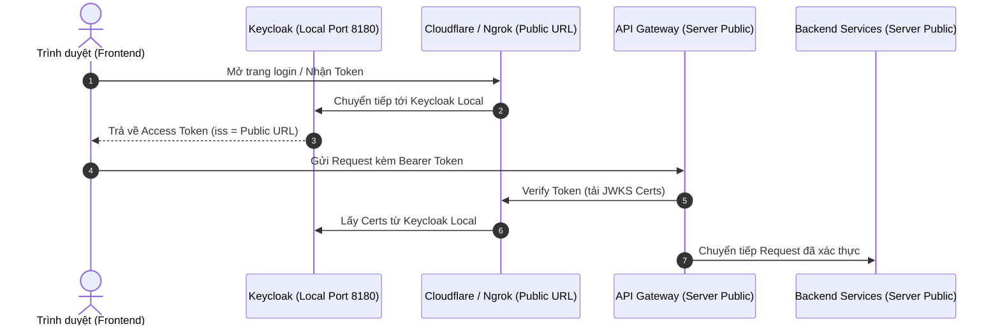

# Hướng Dẫn Chạy Keycloak Riêng Lẻ Tại Local (Các Service Khác Giữ Nguyên Trên Server Public)

Tài liệu này hướng dẫn cách chạy service **Keycloak IAM** tại máy cá nhân (**Local**) bằng file cấu hình có sẵn của dự án, trong khi toàn bộ các container và dịch vụ khác vẫn giữ nguyên chạy trên **Server Public / Cloud**.

---

## 1. Cơ Chế Mạng & Yêu Cầu Kết Nối

### Vấn đề:
Khi các container khác chạy trên Server Public (API Gateway, Backend Services,...):
- Server Public **không thể** gọi trực tiếp vào `http://localhost:8180` trên máy tính cá nhân của bạn (vì `localhost` trên server là chính máy server).
- Theo chuẩn OIDC:
  - Token JWT do Keycloak phát hành chứa claim Issuer: `"iss": "https://<DOMAIN>/realms/ptit-wgs"`.
  - API Gateway trên Server Public phải gọi được vào Keycloak (endpoint `.well-known/openid-configuration` và JWKS certs) để xác thực chữ ký token.
  - Frontend cũng phải mở được trang đăng nhập Keycloak.

### Giải pháp:
Giữ nguyên file docker compose của bạn. Sử dụng công cụ **Tunnel** (như **Cloudflare Tunnel** hoặc **Ngrok**) để tạo một đường dẫn Public HTTPS trỏ về port `8180` của Keycloak Local.



---

## 2. Bước 1: Khởi Chạy Keycloak Tại Local

Sử dụng trực tiếp file `docker-compose.deps.yml` hiện có trong project:

```bash
docker compose -f docker-compose.deps.yml up keycloak -d
```

> **Lưu ý:** Lệnh này sẽ khởi chạy `wgs-postgres-db` (để lưu dữ liệu Keycloak) và `wgs-keycloak` ở port `8180`.

Kiểm tra trạng thái:
```bash
docker logs -f wgs-keycloak
```
Khi log hiển thị `Listening on: http://0.0.0.0:8080`, Keycloak đã chạy xong tại `http://localhost:8180`.

---

## 3. Bước 2: Tạo Public URL Cho Keycloak Local

Mở một cửa sổ Terminal mới và chọn **1 trong 2 cách** sau:

### Cách A: Dùng Cloudflare Tunnel (Miễn phí, không giới hạn)
1. Cài đặt `cloudflared` (nếu chưa có):
   ```powershell
   winget install Cloudflare.cloudflared
   ```
2. Chạy lệnh mở tunnel:
   ```bash
   cloudflared tunnel --url http://localhost:8180
   ```
3. Cloudflare sẽ tạo một URL công khai dạng:
   `https://<subdomain>.trycloudflare.com`

### Cách B: Dùng Ngrok
1. Chạy lệnh:
   ```bash
   ngrok http 8180
   ```
2. Ngrok sẽ in ra địa chỉ Forwarding dạng:
   `https://<subdomain>.ngrok-free.app`

*(Giữ nguyên cửa sổ terminal chạy tunnel này trong suốt quá trình làm việc).*

---

## 4. Bước 3: Cấu Hình Trên Server Public

Để API Gateway trên Server Public nhận diện và xác thực token với Keycloak Local:

1. Mở file `.env` trên **Server Public**, cập nhật biến `KEYCLOAK_ISSUER_URI`:
   ```bash
   KEYCLOAK_ISSUER_URI=https://<URL_TUNNEL>/realms/ptit-wgs
   ```
   *(Ví dụ: `KEYCLOAK_ISSUER_URI=https://random-name.trycloudflare.com/realms/ptit-wgs`)*

2. Khởi động lại API Gateway trên Server:
   ```bash
   docker compose restart api-gateway
   # hoặc: docker restart wgs-api-gateway
   ```

---

## 5. Bước 4: Cấu Hình Frontend

Trong thư mục `web-grading-system-fe`, chỉnh sửa file `.env.development.local`:

```bash
# Trỏ tới API Gateway trên Server Public
VITE_API_PROXY_TARGET=https://web-dev1-api.vucongtuanduong.dpdns.org

# Trỏ tới Keycloak Public URL
VITE_KEYCLOAK_AUTHORITY=https://<URL_TUNNEL>/realms/ptit-wgs
VITE_KEYCLOAK_CLIENT_ID=web-grading-fe
```

Chạy frontend:
```bash
npm run dev
```

---

## 6. Bước 5: Kiểm Tra Hoạt Động (Verification)

### 1. Kiểm tra kết nối từ Server Public tới Keycloak Local:
Đứng trên Server Public (qua SSH), chạy:
```bash
curl -I https://<URL_TUNNEL>/realms/ptit-wgs/.well-known/openid-configuration
```
Nếu trả về `HTTP/2 200` hoặc `HTTP/1.1 200 OK` là Server đã kết nối thành công tới Keycloak Local.

### 2. Test lấy token:
```bash
curl -X POST "https://<URL_TUNNEL>/realms/ptit-wgs/protocol/openid-connect/token" \
  -H "Content-Type: application/x-www-form-urlencoded" \
  -d "client_id=wgs-postman" \
  -d "grant_type=password" \
  -d "username=student_test" \
  -d "password=<test-user-password>"
```

### 3. Gọi API qua Gateway Server Public:
```bash
curl -H "Authorization: Bearer <ACCESS_TOKEN>" \
  https://web-dev1-api.vucongtuanduong.dpdns.org/api/v1/student/assignments
```

---

## 7. Dừng Service Khi Không Dùng

```bash
docker compose -f docker-compose.deps.yml stop keycloak postgres-db
```
Tắt terminal đang chạy `cloudflared` hoặc `ngrok`.
