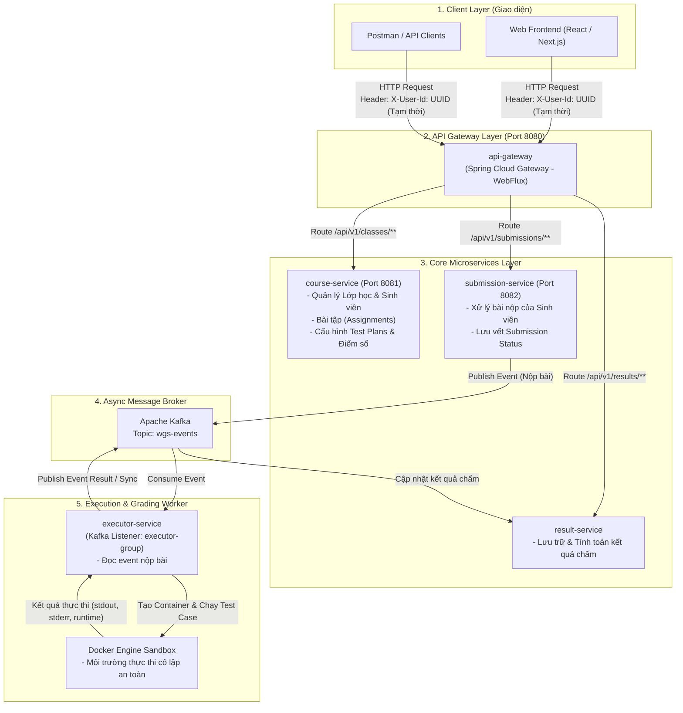

# Tài liệu Kiến trúc Hệ thống Hiện tại
## Web Grading System Backend Services

---

## 1. Sơ đồ Kiến trúc Hệ thống (System Architecture Diagram)

---

## 2. Chi tiết Thành phần Kiến trúc

### 2.1 Client Layer (Tầng Giao diện)
* **Thành phần**: Web Frontend (React/Next.js) hoặc các API Test Client (Postman).
* **Cơ chế xác thực hiện tại**: Chưa tích hợp SSO/Keycloak. Client tự đính kèm HTTP Request Header `X-User-Id: <UUID>` đại diện cho identity của người dùng (Giảng viên / Sinh viên) trong từng request.

### 2.2 API Gateway Layer (`api-gateway`)
* **Công nghệ**: Java 21, Spring Boot 3.x/4.x, Spring Cloud Gateway (WebFlux - Reactive).
* **Cổng dịch vụ**: `8080`
* **Nhiệm vụ**:
  * Đóng vai trò là Reverse Proxy tiếp nhận tất cả HTTP Requests từ bên ngoài.
  * Định tuyến (Routing) request đến các Microservices tương ứng dựa trên URL path pattern:
    * `/api/v1/classes/**` -> `course-service`
    * `/api/v1/submissions/**` -> `submission-service`
    * `/api/v1/results/**` -> `result-service`

### 2.3 Core Microservices Layer
* **`course-service` (Port 8081)**:
  * Quản lý thông tin Lớp học (`Class`), Danh sách sinh viên import từ CSV.
  * Quản lý Bài tập (`Assignment`), cấu hình bộ dữ liệu chạy thử (`Test Plan`).
  * Quản lý & tổng hợp điểm số.
* **`submission-service` (Port 8082)**:
  * Tiếp nhận mã nguồn bài làm của sinh viên từ Frontend.
  * Khởi tạo trạng thái nộp bài và phát hành Event (Publish) lên Message Broker.
* **`result-service`**:
  * Lưu trữ kết quả chấm bài chi tiết sau khi `executor-service` xử lý xong.
  * Cung cấp API truy xuất lịch sử chấm điểm cho sinh viên và giảng viên.

### 2.4 Async Message Broker (Apache Kafka)
* **Công nghệ**: Apache Kafka.
* **Topic chính**: `wgs-events`
* **Nhiệm vụ**: Giao tiếp bất đồng bộ giữa `submission-service` và `executor-service`, tránh tình trạng nghẽn hệ thống khi số lượng bài nộp tăng đột biến.

### 2.5 Execution & Grading Worker (`executor-service` & Docker Sandbox)
* **`executor-service`**:
  * Lắng nghe các event nộp bài từ Kafka topic `wgs-events` với `groupId: executor-group` (`WgsEventsConsumer`).
  * Điều phối quá trình chấm bài tự động.
* **Docker Engine Sandbox**:
  * Mỗi bài nộp của sinh viên sẽ được thực thi trong một Docker Container riêng biệt bị giới hạn tài nguyên (CPU, RAM, Network, Execution Timeout).
  * Đảm bảo tính an toàn cho hệ thống server, chống mã độc hoặc vòng lặp vô tận từ bài làm của sinh viên.

---

## 3. Định hướng Nâng cấp Tiếp theo

1. **Tích hợp Keycloak IAM**:
   * Đặt Keycloak làm dịch vụ Auth tập trung.
   * Cấu hình OAuth2 Resource Server tại `api-gateway` để validate JWT Token.
   * `api-gateway` trích xuất thông tin người dùng từ JWT Token để tự động gắn các Header `X-User-Id`, `X-User-Roles` chuẩn xác xuống các downstream microservices.

2. **Hoàn thiện luồng Phân quyền (RBAC)**:
   * Giảng viên (`ROLE_LECTURER`): Tạo lớp, quản lý bài tập, chấm lại bài.
   * Sinh viên (`ROLE_STUDENT`): Chỉ được nộp bài và xem bài làm của chính mình.
