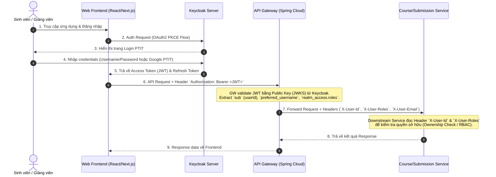

# Tài liệu Thiết kế & Kiến trúc Tích hợp Keycloak IAM
## Web Grading System Backend Services

---

## 1. Tổng quan & Ngữ cảnh Kiến trúc

Hệ thống **Web Grading System** hiện tại đang xây dựng theo kiến trúc Microservices trên nền tảng **Java 21**, **Spring Boot 3.x/4.x** và **Spring Cloud Gateway (WebFlux)**.

### Các dịch vụ hiện có:
* **`api-gateway`**: Entry point tiếp nhận mọi HTTP request từ client (Port 8080).
* **`course-service`**: Quản lý bài tập, lớp học, danh sách sinh viên, điểm số (Port 8081).
* **`submission-service`**: Xử lý bài nộp của sinh viên (Port 8082).
* **`executor-service`**: Thực thi code bài nộp trong môi trường sandbox Docker an toàn.
* **`result-service`**: Quản lý và tính toán kết quả chấm bài.

### Trạng thái Authentication hiện tại:
* Các service đang sử dụng cơ chế định danh tạm thời thông qua HTTP Request Header `X-User-Id` (UUID).
* Cần tích hợp giải pháp **Identity and Access Management (IAM)** chuẩn enterprise để thay thế header tạm thời này.

---

## 2. Đánh giá Lựa chọn Keycloak IAM

### Kết luận: **RẤT NÊN CHỌN KEYCLOAK**

### Lý do chi tiết:

1. **Chuẩn OIDC / OAuth2.0 Native cho Spring Boot & Spring Cloud**:
   * Keycloak là giải pháp IAM mã nguồn mở hàng đầu phát triển bởi Red Hat.
   * Tương thích hoàn hảo với `spring-boot-starter-oauth2-resource-server` của Spring Security mà không cần tùy biến phức tạp.

2. **Xác thực tập trung tại API Gateway (Spring Cloud Gateway)**:
   * `api-gateway` đóng vai trò là OAuth2 Resource Server duy nhất xác thực JWT Token từ client thông qua endpoint JWKS (`/protocol/openid-connect/certs`) của Keycloak.
   * Gateway tự động extract thông tin người dùng (`user_id`, `username`, `roles`) và forwarding xuống các downstream microservices qua HTTP Request Headers (`X-User-Id`, `X-User-Roles`, `X-User-Email`).

3. **Phân quyền Role-Based Access Control (RBAC) linh hoạt**:
   * Hệ thống có 3 vai trò chính:
     * `STUDENT`: Sinh viên nộp bài, xem lịch sử & kết quả của mình.
     * `LECTURER`: Giảng viên tạo lớp học, bài tập, cấu hình test plan, quản lý điểm số.
     * `ADMIN`: Quản trị viên hệ thống, quản lý người dùng & tài nguyên sandbox.
   * Keycloak cung cấp sẵn **Realm Roles**, **Client Roles**, **Groups**, và **Attributes** giúp loại bỏ việc tự xây dựng các bảng `users`, `roles`, `permissions` phức tạp trong database.

4. **Khả năng mở rộng SSO với Trường Đại học (PTIT)**:
   * Tích hợp sẵn tính năng **Identity Brokering / Social Login** (Google Workspace `@student.ptit.edu.vn` / `@ptit.edu.vn`, LDAP/Active Directory của nhà trường).
   * Không phải thay đổi bất kỳ dòng code backend nào khi thêm phương thức đăng nhập mới.

5. **Bảo mật Enterprise có sẵn**:
   * Quản lý phiên (Session Management), Token Revocation (thu hồi token ngay lập tức khi phát hiện rủi ro).
   * Refresh Token Rotation, Chống tấn công Brute-force, Mã hóa mật khẩu an toàn (Argon2/PBKDF2).
   * Kích hoạt tài khoản qua Email, Quên mật khẩu, Bảo mật 2 lớp (MFA/TOTP).

---

## 3. Kiến trúc Luồng Xác thực & Phân quyền (Authentication Flow)



---

## 4. Thiết kế Chi tiết Tích hợp Kỹ thuật

### 4.1 Cấu hình Keycloak Realm & Client
* **Realm Name**: `ptit-wgs` (PTIT Web Grading System)
* **Client Name**: `wgs-frontend` (Public Client, Authorization Code Flow with PKCE enabled)
* **Client Name**: `wgs-gateway` (Confidential Client hoặc Bearer-only Resource Server)
* **Roles**:
  * `ROLE_STUDENT`
  * `ROLE_LECTURER`
  * `ROLE_ADMIN`

### 4.2 Cấu hình tại `api-gateway`

#### Maven Dependency:
```xml
<dependency>
    <groupId>org.springframework.boot</groupId>
    <artifactId>spring-boot-starter-oauth2-resource-server</artifactId>
</dependency>
```

#### Application Configuration (`application.yml`):
```yaml
spring:
  security:
    oauth2:
      resourceserver:
        jwt:
          issuer-uri: http://localhost:8080/realms/ptit-wgs
          jwk-set-uri: http://localhost:8080/realms/ptit-wgs/protocol/openid-connect/certs
```

#### Gateway Filter Forwarding User Context (`GlobalFilter`):
```java
@Component
public class AuthenticationHeaderFilter implements GlobalFilter, Ordered {
    @Override
    public Mono<Void> filter(ServerWebExchange exchange, GatewayFilterChain chain) {
        return exchange.getPrincipal()
            .cast(JwtAuthenticationToken.class)
            .map(JwtAuthenticationToken::getToken)
            .map(jwt -> {
                String userId = jwt.getSubject();
                String email = jwt.getClaimAsString("email");
                List<String> roles = jwt.getClaimAsStringList("roles");

                ServerHttpRequest request = exchange.getRequest().mutate()
                    .header("X-User-Id", userId)
                    .header("X-User-Email", email != null ? email : "")
                    .header("X-User-Roles", String.join(",", roles))
                    .build();
                return exchange.mutate().request(request).build();
            })
            .defaultIfEmpty(exchange)
            .flatMap(chain::filter);
    }

    @Override
    public int getOrder() {
        return SecurityWebFiltersOrder.AUTHORIZATION.getOrder() + 1;
    }
}
```

### 4.3 Cấu hình tại Downstream Services (`course-service`, `submission-service`,...)
* Downstream Microservices không cần giao tiếp trực tiếp với Keycloak (giảm độ trễ).
* Đọc context người dùng từ Request Header `X-User-Id` và `X-User-Roles` (thay thế cho uuid tạm thời đang dùng).

---

## 5. Lộ trình Triển khai (Roadmap)

1. **Giai đoạn 1: Dựng môi trường Keycloak**
   * Thêm Keycloak container vào `docker-compose.yml` dự án.
   * Tạo Realm `ptit-wgs`, cấu hình Roles (`ROLE_STUDENT`, `ROLE_LECTURER`, `ROLE_ADMIN`) và Client `wgs-frontend`.

2. **Giai đoạn 2: Tích hợp API Gateway**
   * Thêm Spring Security OAuth2 Resource Server vào `api-gateway`.
   * Viết Filter trích xuất JWT claims và chuyển đổi thành Headers `X-User-Id`, `X-User-Roles`.

3. **Giai đoạn 3: Cập nhật Downstream Services**
   * Chuẩn hóa Filter/Interceptor ở các service để đọc header `X-User-Id` chuẩn UUID từ Keycloak.
   * Thêm kiểm tra vai trò (Role checks) cho các API nhạy cảm (Tạo bài thi, chấm lại, cấu hình sandbox).

4. **Giai đoạn 4: Tích hợp Frontend & Kiểm thử**
   * Kết nối Client Frontend với Keycloak bằng OIDC SDK (`oidc-client-ts` hoặc `keycloak-js`).
   * Kiểm thử toàn bộ luồng End-to-End.
